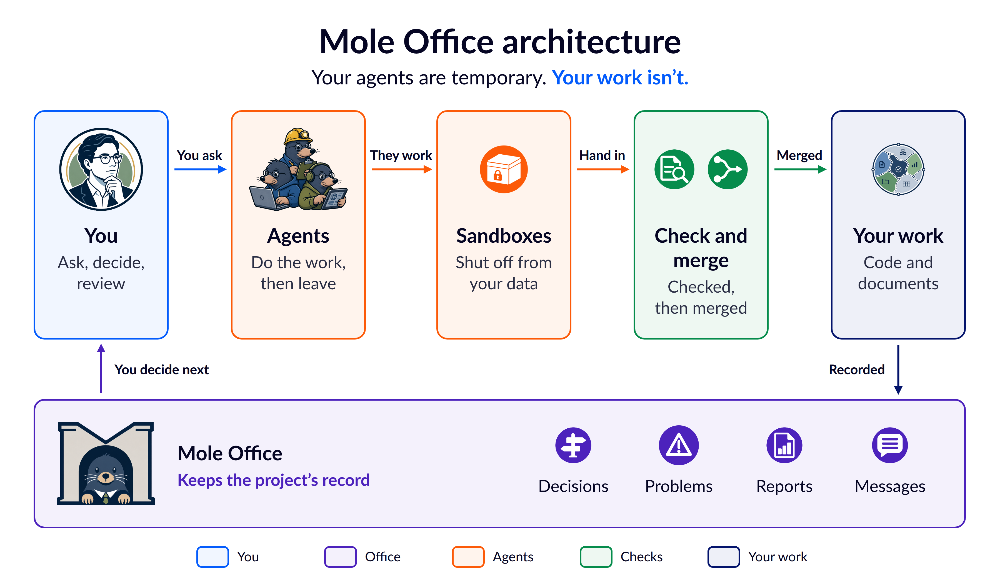
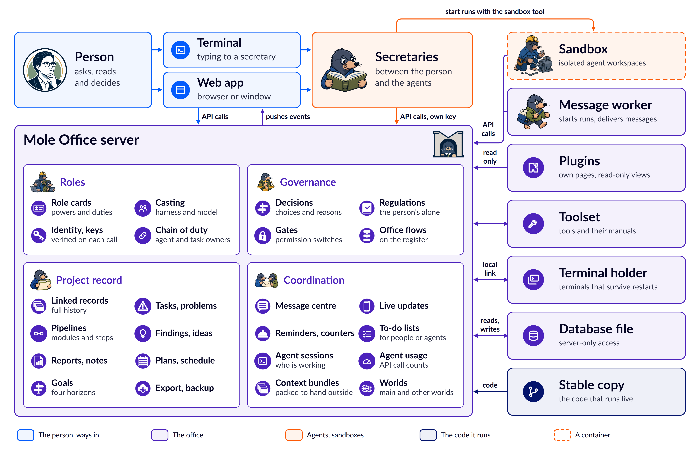
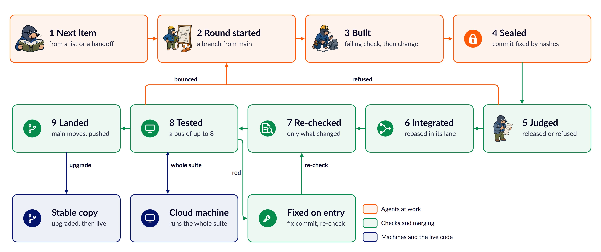

<h1 align="center">
  &nbsp;&nbsp;Mole Office
</h1>

<p align="center"><strong>Your agents are temporary. Your work isn't.</strong></p>
<p align="center">A durable project office for people and agents.</p>

<p align="center"><strong>English</strong> · <a href="./readme/README_zh.md">中文</a></p>

<p align="center">
  
</p>

Mole Office keeps the project alive across workers, sessions, tools, and conversations.

Plans, work, decisions, findings, reports, provenance, and history stay with the project — so the
next worker can continue instead of reconstructing everything from scratch.

> **Agents work. The Office remembers.**

## Why it exists

You run many agent sessions. Each one does real work and writes a good report. The reports pile up
faster than anyone can connect them. The reports are not the problem. Three other things are:

- **State lives in the wrong place** — in a conversation, in your memory, and in open terminal
  windows. A reboot destroys all three.
- **Nothing records who should use a result.** Each report names its own findings. None of them
  names what should change because of it, so a measurement and a document saying that measurement
  is missing can sit in adjacent folders for a month.
- **Work owed is not separated from work known.** A required fix gets filed as an interesting fact.
  A fact has no due date, so nothing ever becomes overdue.

Mole Office keeps two layers. Your **archive** — reports, code, data — stays exactly where it
already is and is never copied. The **tracking layer** is small, linked, and is the only part you
have to hold in your head.

## What stays

- **Project structure** — plans, work, modules, pipelines, problems, decisions, findings, and reports
- **Project history** — revisions, provenance, checkpoints, and evidence
- **Coordination** — review, messages, work presence, scope, and handoff
- **Implementation context** — links between project meaning and repositories
- **Uncertainty** — placeholders, contradictions, and incomplete work stay explicit

## How it works

1. A human expresses intent.
2. A worker gets the project context it needs.
3. Work, evidence, review, and decisions return to the Office.
4. The next worker continues from durable project state.

Your agents keep their native runtimes. Git remains Git. Mole Office is the durable layer around the
project.

**Git owns implementation history. Mole Office owns project meaning, coordination, and evolution.**

<p align="center">
  
</p>

[中文版](assets/architecture/general-zh.png) · [SVG source](assets/architecture/general-en.svg) · [中文 SVG](assets/architecture/general-zh.svg)

The technical picture shows what the office is made of and how the parts connect. See [Architecture](docs/architecture.md).

<p align="center">
  
</p>

[中文版](assets/architecture/technical-zh.png) · [SVG source](assets/architecture/technical-en.svg) · [中文 SVG](assets/architecture/technical-zh.svg)

The development flow picture shows one round, from the next item to the landing and the live office.

<p align="center">
  
</p>

[中文版](assets/architecture/flow-zh.png) · [SVG source](assets/architecture/flow-en.svg) · [中文 SVG](assets/architecture/flow-zh.svg)

## Installation

> **Pre-release:** an npm package has not been published yet.

Use the repository development setup below, including the skill link.

To build the installers for Linux, Windows and the Mac yourself, and to read what does not work yet, see
[RELEASE-NOTES.md](RELEASE-NOTES.md).

<!--
ENABLE ONLY AFTER THE PACKAGE/CLI SHAPE IS REAL AND VERIFIED.

Possible future forms — choose the one that matches the actual packaging:

npm install -g mole-office

or, if it is intended to run without a global install:

npx mole-office

or, if packages are organization-scoped:

npm install -g @mole-office/cli
-->

## Running it

```bash
npm install                 # needs Node 22 or newer
cp .env.example .env      # every setting has a working default; read the comments before changing one
ln -s "$PWD/.claude/skills/mole-office" "/path/to/your/agent/skills/mole-office"  # replace the target with your agent's skills directory
npm run db:migrate
npm run db:seed           # sample data, so the screens have something on them
npm run dev               # API on 8787, browser app on 5173
```

`npm run dev` runs the API under Mole Office's own development supervisor: it restarts the server when
a file the server is built from changes, restarts it after a crash, and the runtime page (`#/runtime`)
names the supervisor and the reason for the last restart.

> **Important:** Link the Mole Office skill into your agent's `skills` directory. Mole Office can
> run without that link, but the agent will not know its project workflow and will be much harder
> to use effectively.

Open http://127.0.0.1:5173.

Your work lives in one SQLite file and that file is the only copy. Take a copy with
`npm run db:backup` before anything that migrates or resets — not with `cp`, which loses recent
writes. [docs/development.md](docs/development.md) has the commands, the ports and the traps.

## Talking to an agent in Mole Office – Right click anything

<details>
<summary>See how the interaction works</summary>

Select something, say what you want, and an agent gets that exact context. A plan line, a scheduled
block, a record, a row in a list, or words you select inside prose all carry a handle that opens one
small box: what you picked, what you want, and who it is for.

**Three ways to open that box, and right-click is the fastest.**

| gesture | what it does |
|---|---|
| **Right-click anything** | Opens the box about that thing, in one press. |
| **`Shift+F10`** | The same, from the keyboard, about whatever has focus. |
| **`Ask agent` in the rail** | Press it, then press the thing. This is the way in on a touch screen, a tablet, and anywhere a right-click is not available. |

The rail control teaches the gesture on its own description, and the rail no longer draws a line
beside it at rest, so the two channels still teach one gesture rather than two.

</details>

## An Office

An **Office** is a durable project environment shared across temporary workers.

Skills help a worker do something. Harnesses guide a worker while it works. An Office keeps the
project coherent after that worker is gone.

> **Mole Office turns temporary intelligence into institutional intelligence.**

## Operating principles

- **One fact, one identity, many projections.**
- **Truth before convenience.**
- **Absence beats a guess.**
- **Human governance stays human.**
- **Defer locally, continue globally, reconcile before completion.**
- **Every worker should leave the project richer than they found it.**

Three of these are enforced in code rather than hoped for.

- *Truth before convenience* means a method that cannot run fails and says so. Substituting a
  different method and reporting success is forbidden, because the result would then be evidence
  about something nobody asked for.
- *Absence beats a guess* means `unknown`, `unverified` and "nobody has looked" are real answers.
  Mole Office keeps *nothing is there* and *nobody has looked* apart, and says which one it means.
- *Human governance stays human* means the acts reserved to the person are refused to an agent,
  with a message saying what to file instead. See [docs/governance.md](docs/governance.md).

## What works today

<details>
<summary>Open the verified capabilities available today</summary>

Every line below was checked against the running product, the first group on 27 August 2026 and the
second on 3 and 4 September 2026 by independent verifiers. How each one was checked, with the request
and the reply, is in [docs/verification.md](docs/verification.md) for the first group and in the
verifier reports under `design/*/verification/` for the second.

- **Context bundles.** `GET /api/bundles/preview` assembles the project context for a named purpose
  — continue this work, critique a module, investigate a problem, recover a project — and puts what
  limits that text at the top of it.
- **History and provenance.** Every write is attributed and kept. A record's revisions can be read,
  compared and restored, and the change log is a separate durable table.
- **The implementation map.** A record can be joined to the code that implements it, and each join
  says whether a person stated it or the product guessed it.
- **Sessions and agent runs.** A session is a record, a run is a row a worker claims, and the API
  answers where a run belongs and on what evidence.
- **A queue of what waits on the person.** `GET /api/waiting` answers with everything whose move is
  the person's: forks to settle, records an agent asked them about, messages to them they have not read,
  and agents waiting to be let in, each with the act it asks for and why it is theirs.
  `GET /api/needs-you` is the shorter list of forks, card requests and admissions, with those counts.
- **Typed records and links.** One store holds every kind of thing a project knows, and typed links
  join any two of them. `GET /api/kinds` serves the kinds, their fields and the link types, so
  nothing has to be copied into a document that can go stale.
- **Modules, blocks and pipelines.** A module is a subsystem you would write a report about. A
  pipeline is an ordered set of blocks, and a block is its own record with its own history.
- **Export and restore.** The whole corpus exports as readable Markdown and comes back from it. The
  destructive restore proof was run on 27 August 2026: fourteen phases, twenty-six comparisons held,
  none vacuous, and the three things that do not round-trip are named by the proof itself.
- **Search.** `GET /api/search` answers with the records that match and the words that matched.
- **Projects.** A record, a link and a change row each belong to one project, and every request
  says which project it is about.
- **A write path that is strict about keys and forgiving about how much you have written.** A
  misspelt field is refused with the field it probably meant, and nothing is stored. A record with
  a title and nothing else is stored, and is counted incomplete until the rest arrives.

Added since, and verified the same way:

- **Seven reading lengths for a report.** A label, a title, a conclusion, and three summaries written
  part by part, up to the full text; a level that was not written says so, and nothing stands in.
- **Acting on a quoted sentence.** An agent may accept, close or reclassify on a quoted sentence the
  record holds; the record shows the sentence, and one press by the person revokes the act.
- **The product knows its own world.** Every reply names the database, the repository, the port,
  the commit and whether it is the canonical world; a page in the wrong world is blocked by a red
  banner and says why; freshness is measured against the files each half is built from; every
  process a test or an agent starts is registered with its owner and its world.
- **People and agents are participants.** Two registries at installation level, each with a name, a
  handle, a picture (drawn from the id, or uploaded) and a self-set state.
- **One message pool and a live chat.** Messages between people and agents, with a delivery mark
  per recipient, reach an open page over one event stream in milliseconds; a circle at the bottom
  right opens the chat; presence is worked out from live runs, never declared.
- **Agents comment on the page and lead you there.** An agent's message may point at a block, a
  region or a span and is drawn beside it; a lead moves the page only after you consent, and one
  press stops it.
- **A worker that runs agent tools.** A message to an agent starts or resumes a run of Claude Code,
  Codex or OpenCode inside the checkout, with the database reachable only through the API; the
  reply is filed into the pool; runs are bounded and stoppable from the product.
- **Groups and work claims.** A group is a conversation with several members; an agent claims what
  it is working on, and two claims on the same thing open a group with both agents and the owner in
  it.
- **An audited test suite.** Every test file is classified by the rule it protects, whether it goes
  red when the rule is broken, and whether it asserts something nobody decided.

</details>

## What is being built toward

<details>
<summary>Open the capabilities now being developed</summary>

These are designed and partly built. Nothing here is finished, and the product says so where you
meet it rather than showing an empty result that looks like an answer.

- **Richer review and continuation.** Review collects comments and sends them to agents today. The
  continuation half — a worker picking up exactly where the last one stopped — is not finished.
- **Explicit uncertainty.** A placeholder marks something deliberately unresolved and limits what
  the work around it may claim. The kind and the machinery that reads it exist.
- **Reaching the canonical world from another machine.** The criteria are written: a page served
  over the owner's private network talks to the same world, carries the same facts and the same
  banner, and a remote client is named; the build is under way.
- **Citizens, worlds and the office.** Every person and agent is a citizen of a home world; a world
  is born and dies on record; a visit to another world is registered at an office in the main world,
  and the main world's page lists the worlds, enters one and returns. The criteria are written on
  a recorded rule of 4 September; it is built next.
- **Identity.** There is no login. Who a caller is comes from a request header, and that is
  attribution, not authentication. Citizenship comes first; the pass a home world signs comes after.

</details>

## Documentation

This README is intentionally short. The detail is in [docs/](docs/README.md), organised by the
question you are asking:

| You want to know | Read |
|---|---|
| What the words mean — Office, module, block, pipeline | [docs/concepts.md](docs/concepts.md) |
| How a project is stored — records, links, completeness | [docs/project-model.md](docs/project-model.md) |
| How the system is put together | [docs/architecture.md](docs/architecture.md) |
| How an agent reads and writes | [docs/agents.md](docs/agents.md) |
| Who is working, and what happens when nobody is | [docs/lifecycle.md](docs/lifecycle.md) |
| How review works | [docs/review.md](docs/review.md) |
| What only the person may decide | [docs/governance.md](docs/governance.md) |
| Plans, hours and what somebody wrote about time | [docs/planning.md](docs/planning.md) |
| How project meaning joins to code | [docs/implementation-map.md](docs/implementation-map.md) |
| How to hand a worker its context | [docs/context-bundles.md](docs/context-bundles.md) |
| How unresolved things are kept unresolved | [docs/placeholders.md](docs/placeholders.md) |
| Reaching it from another machine | [docs/remote-access.md](docs/remote-access.md) |
| Running it, and the traps | [docs/development.md](docs/development.md) |
| How claims here were checked | [docs/verification.md](docs/verification.md) |
| The images, and what a favicon still needs | [docs/brand.md](docs/brand.md) |

## License

Mole Office is released under the MIT License. The licence is in [LICENSE](LICENSE), and [NOTICE](NOTICE) says the same in one line.
