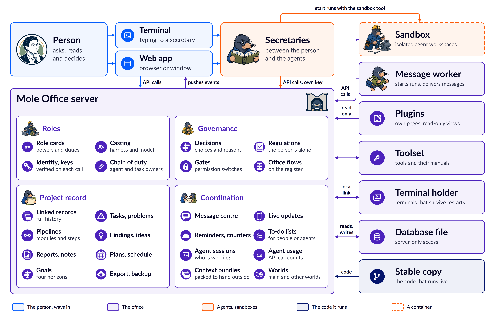

# Architecture

[中文版](../assets/architecture/technical-zh.png) · [SVG source](../assets/architecture/technical-en.svg) · [中文 SVG](../assets/architecture/technical-zh.svg)

The picture is generated by [tools/architecture/draw.mjs](../tools/architecture/draw.mjs) from
[tools/architecture/diagrams.json](../tools/architecture/diagrams.json). Its
[source trace](../assets/architecture/technical-sources.md) connects the boxes and arrows to code.
This explanation was written from the secretary agent's inventory of `cd2dc7b` and checked against the code on
30 September 2026. Where a number would drift as the code grows, it names the file that holds it instead.

## The user's machine

The browser, agent sessions, server, database, message worker and sandbox containers run on the
user's machine. They are separate clients and processes. The server is one Node process; the
message worker and the tools it starts are additional processes.

The server's primary listener binds to loopback. The default API port is **8787**, and the default
Vite development port is **5173**. These defaults and the settings are declared in
[src/config/settings.mjs](../src/config/settings.mjs). The code also supports two optional doors
for other machines: `MOLE_OFFICE_REMOTE_PORT` adds a loopback listener for a proxy, and
`MOLE_OFFICE_ADDRESS_FOR_OTHER_MACHINES` adds a listener on a specified machine address. The
primary loopback binding is fixed; it does not mean that all access is confined to that listener.
[src/server/index.ts](../src/server/index.ts) starts and classifies these listeners.

The source is divided by responsibility:

| Location | Responsibility |
|---|---|
| `src/shared/` | Contracts shared by server and web app: kinds, links, addresses, blocks and time |
| `src/config/` | Settings, runtime installation, identity and sandbox configuration |
| `src/web/` | React browser app |
| `src/server/api/`, `src/server/lib/`, `src/server/db/` | HTTP routes, core operations, schema and database connection |
| `src/worker/` | Message delivery and runtime adapters |
| `tools/` | Sandbox, inspection, merge, hooks, guards, diagram generation and review tools |
| `sandboxes/` | Container templates |
| `drizzle/`, `scripts/` | SQL migrations and database maintenance commands |
| `.mole-office/` | Protected-area and generated-file declarations |
| `.claude/skills/mole-office/` | The agent skill linked by the entry installer |
| `tests/`, `docs/`, `design/` | Tests, documentation, and design criteria and evidence |

## The web app

The app is React through Vite, with a hash router whose addresses are declared in
[src/shared/addresses.ts](../src/shared/addresses.ts). Vite serves it during development; the
server serves the built app in production.

[src/web/api.ts](../src/web/api.ts) sends HTTP API requests directly to the configured API port
at the host the page came from. There is no Vite API proxy or private browser back channel. The
wrapper carries project, actor, session and visit headers. Pairing gives the browser an HttpOnly
cookie holding the user's key; requests send it with `credentials: 'include'`, rather than exposing
that key to the page's JavaScript.

The app hears live changes through `GET /api/events`, a server-sent event stream read with `fetch`
so it can carry headers. [src/web/lib/channel.ts](../src/web/lib/channel.ts) reads the stream,
and [src/web/lib/onestream.ts](../src/web/lib/onestream.ts) shares it across tabs. Chat, comments,
reviews and the right-click **Ask agent** interaction use the same API and message pool.

## The server and its capabilities

[src/server/index.ts](../src/server/index.ts) builds the Fastify app and registers its API groups.
`GET /api` describes the routes, their operations and whether they are local to this machine or
available remotely. `GET /api/kinds` serves the record shapes from the declarations that enforce
writes. `x-mole-office-workspace` selects a project; records, links and changes belong to that
project. An omitted project uses the declared default, not the project with the most records.

Request handling checks the caller's machine, route reach, key proof, role powers and visitor
credentials, and records API usage. Actor headers supply attribution; keys prove a holder. An
agent's key under another identity is refused, subject to the explicit rule allowing a supervisor's
run key to act for a run it started. The key-window rules define the limited cases in which a
caller without a key can be accepted. Replies identify the answering world and its freshness.
The implementation is in [keyheader.ts](../src/server/lib/keyheader.ts),
[rolegate.ts](../src/server/lib/rolegate.ts) and [visits.ts](../src/server/lib/visits.ts).

The capability groups in the picture correspond to these operations:

| Group | What the server provides |
|---|---|
| Project record | Typed records and links, full revisions and change history, reports with prose/chart/table/picture/file blocks and short forms, plans and schedules, Markdown export/import and a git mirror |
| Governance | Decisions and proposals, user-owned regulations, caller identity and keys, role cards and temporary authority |
| Coordination | Messages and delivery marks, events to open pages, reminders and counters, worlds, visitors and the Embassy |
| Office flows | A register of procedures, their stages and the problems linked to them |

A decision names who decided. An agent records a decision only with the required authority or a
warrant carrying the user's quoted words; otherwise it files a proposal. Regulations belong to
the user, and only the user may revoke them. Role cards define what an agent may do. A user-granted
elevation lets a secretary act for a limited time or task, and writes cite that grant. These rules
are enforced by [records.ts](../src/server/lib/records.ts),
[regulations.ts](../src/server/lib/regulations.ts) and [roles.ts](../src/server/lib/roles.ts).

The server runs reminder and counter ticks and visit retries. It can send Web Push notifications;
summons can also be mailed by the separate [mail tool](../tools/mail-the-summonses.mjs). Runtime
and health routes report processes, worlds and stale code. The Embassy tracks citizens, visits,
trusted machines and visitor credentials.

The server starts the message worker through
[src/server/lib/resources.ts](../src/server/lib/resources.ts). That module also contains controlled
OS operations such as reading git for a seal and stopping a sandbox. The OS boundary test confines
process operations to declared modules and exceptions; it does not prohibit every process start
under `src/`.

## The database

[src/server/db/client.ts](../src/server/db/client.ts) opens one SQLite file with better-sqlite3
and exposes it through Drizzle. `MOLE_OFFICE_DB` names the file. Every table is declared in
[src/server/db/schema.ts](../src/server/db/schema.ts), and every change to them is a numbered SQL
migration under [drizzle/](../drizzle/). This page gives no counts of either, because both grow with
nearly every change to the office.

Records of different kinds share `records`; a report, message or decision is not a separate table.
`links` joins records, `changes` stores attributed changes, and `revisions` keeps complete record
versions. See [project-model.md](project-model.md) and [history.md](history.md).

Chat uses message records plus `message_delivery` for each recipient's delivery state, conversation
reads, groups and contact tables. The older `agent_threads`, `agent_messages` and `agent_runs`
tables support the earlier review/dispatch mechanism. They do not describe the current chat pool.
Other tables support planning, people and agents, worlds and visits, issued-key hashes, resources,
handle holds, work claims, counters, usage and the implementation map. `panel_layouts` is retired:
no route writes it, and since 29 September 2026 no backup and no export carries it (an import of an
older archive that holds a layout writes none and says so). `presentation_intent` stores meaning such
as order, lanes and emphasis, from which layout is derived.

The server reads and writes the database while serving. API clients, workers and sandbox agents do
not open it. Maintenance scripts and the merge tool's backup and migration steps operate on it
separately. The server refuses to serve authored work that needs migration. Backups are kept beside
the database, and Markdown export and the git mirror provide additional durable representations.
Timestamps use the shared local wall-clock reader and writer in
[src/shared/time.ts](../src/shared/time.ts).

## Agents' sessions

An agent session is a client of the office. For Claude Code,
[tools/session-hook.mjs](../tools/session-hook.mjs) handles SessionStart, Stop and SessionEnd:
it reads onboarding and context, files a session, then records the session's progress and end.
The hook uses the agent's own key once the agent is registered and its key is set; before that it
uses the office's key. The entry installer in
[src/config/install-the-entry.mjs](../src/config/install-the-entry.mjs) installs the hooks and
links the repository's `.claude/skills/mole-office/` skill. DeepSeek's dsh runner has its own
[hooks](../tools/dsh-hooks/hooks.json) and office-request tool.

A live session can hold its agent's handle. The
[waiter](../tools/hold-the-handle.mjs) beats the hold and long-polls
`GET /api/handles/:handle/waiting?wait=30` for queued messages across projects. The session reads and
marks messages through the API. While a live session holds the handle, the message worker starts
no competing run for that agent. A person or agent session can start a sandbox run through the
sandbox tool, naming the starter and its session.

## Sandboxes

[tools/sandbox.mjs](../tools/sandbox.mjs) creates Docker containers from the templates in
`sandboxes/`. Each instance has a writable folder holding its checkout or worktrees, isolated
home, logs and output. The source checkout is mounted read-only, and its database folder is
covered. A sandbox has no office database or server inside it and cannot read the user's database
or office key files.

Agents such as Claude Code, Codex and DeepSeek run there with a temporary key issued for that run.
They call the office over its API; the key is revoked when the run ends. The ordinary development
template uses the host network. The merge tool uses sandboxes with no network for integration and
testing. These are distinct uses of the sandbox mechanism.

Containers and their processes are recorded in the resources ledger. The sandbox tool registers
and stops them through the API. Outside a sandbox, the
[main-world guard](../tools/guard/policy.mjs) restricts destructive operations and access to
protected databases, keys and credentials; runtime permissions depend on a sandbox or that guard.

## The message worker

[src/worker/index.ts](../src/worker/index.ts) is a separate process started and recorded by the
server. It communicates through HTTP with the office's key and has no direct database access.
It delivers messages, recovers runs after a worker restart, monitors exits and waits, and starts
agent runs, checks and the merge tool.

For an agent run, it obtains a brief, files the run and its resources, holds the agent's handle,
starts the runtime in the checkout and records the reply in the message pool. The adapters in
[src/worker/runtimes/](../src/worker/runtimes/) dispatch Claude Code, Codex, OpenCode and Kimi.
DeepSeek's dsh runner is started by the sandbox tools instead. Worker-started agent runs are not
automatically container runs; the picture therefore has no worker-to-sandbox arrow.

Dispatch is bounded by concurrent-run and message-hop counts. Ordinary agent runs have no worker
wall-clock limit; inspection runs have a check clock. `MOLE_OFFICE_MESSAGE_WORKER` defaults to
`on`; `off` disables the worker, and `merges-only` starts the merge tool, the rounds asked through
the next-round door and the worker runs asked through the worker-run door, without starting a run for
a message. In that mode it starts inspection runs only
while the office says checks run in that mode. These are supported code settings, not a description of a particular installation.
`npm run agent` invokes the older [tools/agent-worker.mjs](../tools/agent-worker.mjs), not this worker.

## The check and the merge tool

The [checker](../tools/the-inspector.mjs) reviews one finished, sealed run against the office
regulations. It reads the sealed commit in its own worktree, or pinned copies for a file submission,
and posts a release or refusal through `POST /api/checks/:run`. Only an inspector may refuse.
Its verdict names the seal; a later edit is not covered by that release. Deterministic checks in
[tools/checks/](../tools/checks/) are separate from this model review and read the protected-area
and generated-file declaration in [.mole-office/protected.json](../.mole-office/protected.json).

The [merge tool](../tools/the-merger.mjs) consumes `merge_entry` records through the API. The server
owns queue transitions; ordinary record writes cannot change an entry. Entries carry the seal's
identity and hash, the changeset and a lane. The tool pins and verifies the sealed submission,
integrates it onto main in an offline sandbox and requests a new inspection when integration
requires one. It builds and tests there, then lands by checking main's expected commit, backing up
the database, fast-forwarding the checkout and running migrations when migration files came along.
It waits for the resulting server's health and records the outcome.

## The change path

The numbered path in the picture is the code-change path:

1. **Sealed.** Finishing a run produces a `sealed_tip` with its commit and file hashes. The seal fixes
   what the checker and merge tool read. Project review settings determine whether finishing also
   requests a check.
2. **Checked.** The checker releases or refuses the sealed run. A queue entry can become judged
   only on a release tied to its seal.
3. **Queued and tested.** The tool pins, integrates and tests the change. The queue owns the whole
   suite run; each red file is run alone, and a file that stays red is also compared with main.
   Entries can bounce for correction or retry when main moves. The documentation lane can carry
   forward the suite evidence when the recorded test reads show that no test reads the changed files.
4. **Merged into main.** The tool verifies that main is still at the expected commit, backs up,
   fast-forwards and migrates when needed. The development supervisor restarts on changes to files
   the server is built from, and the merge tool checks health before reporting the landing.

[src/server/lib/sealed-tip.ts](../src/server/lib/sealed-tip.ts),
[src/server/lib/merge-state-machine.ts](../src/server/lib/merge-state-machine.ts) and the modules in
[tools/merge-tool/](../tools/merge-tool/) enforce this path. The queue records the detailed states
from submission and pinning through judging, integration, testing and landing, including refusal,
withdrawal and supersession outcomes.

## Office flows

A `flow` record describes a registered procedure: who runs it, what triggers it and its stages.
`GET /api/flows` lists the project's flows and linked live problems; individual records carry the
procedure itself. The **User asks → Sandbox work → Check → Merge** tile summarizes that capability.
The register is read by [src/server/api/flows.ts](../src/server/api/flows.ts); it does not execute
stages or gate operations. The seal, inspection and merge-queue code enforces the change path.
Flow records are project data, so the diagram's registered procedures are not a fixed list shipped
with every installation.
