# The avatars

Pictures a participant can be given, for criterion M30. Two sets: the drawn set — twelve animals
drawn by hand as SVG, and a photograph of a bee — and a set generated by an image model on OpenRouter.

**The bee is the default.** `png/chill-bee.png` is a photograph added on 6 September 2026, and it
is the picture a person or an agent gets when nobody chose one, in every installation.
It sits in `png/` because that directory **is** the drawn set — the product reads the files rather
than a list — and one place decides that it is the default: `THE_DEFAULT_PICTURE` in
`src/server/lib/avatars.ts`, which `avatarOfferedTo` answers with. Everything else in both sets is
still offered; this says only which one is recommended. It has no SVG beside it, because it is a
photograph and not one of the drawings.

**The product serves them.** `GET /api/avatars` lists both sets, read off `png/` and `generated/` on
every request, and `GET /api/avatars/<set>/<name>` serves one picture's bytes. So a picture added to
either directory is offered without any file here or in `src/` being edited. The picker is on the
roster of the Who is working page, for any agent, and on the settings page, for the person's own;
pressing a picture fetches its bytes and sends them to `POST /api/participants/:kind/:id/avatar`,
which is the same request choosing a file from a disk makes.

## The style rules for the drawn set

1. One disc, 256 by 256, and everything is drawn inside it — a clip path cuts anything that spills.
2. Twelve background hues, one each, all at the same lightness, so every face reads on a white page and on a black one.
3. Flat fills only: no gradient, no filter, no shadow, no external font and no external image.
4. Big shapes and few of them — the animal is told by its silhouette, then by two or three flat patches.
5. Eyes are dark discs with one white highlight, in the same place on every face; a stroke is only ever a whisker or a mouth.

## The twelve drawn animals

| | | | |
|---|---|---|---|
| 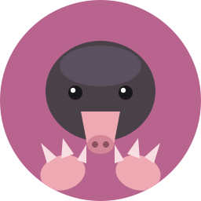 mole | 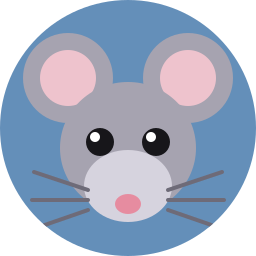 mouse | 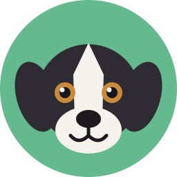 sheepdog | 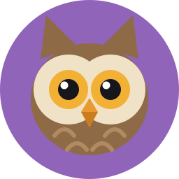 owl |
| 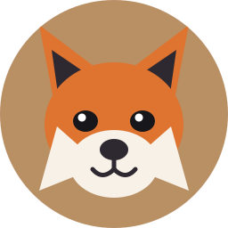 fox | 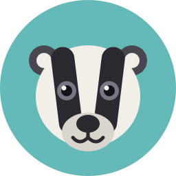 badger | 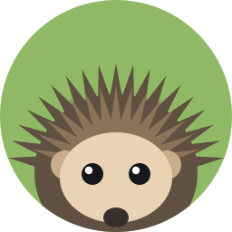 hedgehog | 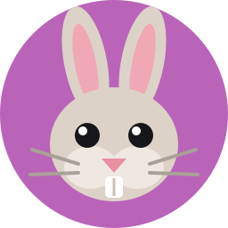 rabbit |
| 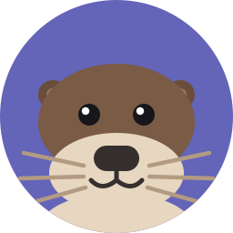 otter | 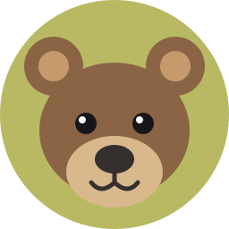 bear | 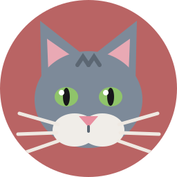 cat | 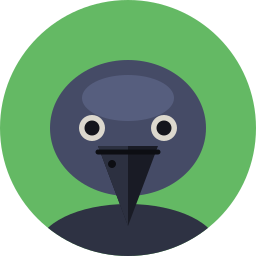 raven |

## Why there are PNG files too

`POST /api/participants/:kind/:id/avatar` takes png, jpeg and webp and refuses SVG on purpose: an
SVG is a document the browser executes, and this product hands an uploaded file back to a page. So
each drawing has a 512 by 512 PNG beside it in `png/`, and that is what is uploaded.

Remake them after changing any drawing:

    node tools/avatars-to-png.mjs

It puts the SVG inline in a blank page at 512 square and photographs it with the Playwright this
checkout already has. The corners outside the disc stay transparent.

## The generated set

`generated/` holds pictures made by an image model, one per file, through:

    node tools/avatars-from-openrouter.mjs <name> "<what to draw>"

The tool needs `OPENROUTER_API_KEY` in the environment or in this checkout's `.env`, which is
git-ignored. Without it the tool says so in one sentence and exits 2 without asking anything. The
key is never printed, logged or written into a file, and it is not a `MOLE_OFFICE_` setting: the
tool's header says why, and how it is read instead.

**What was run.** Forty-two pictures on 4 September 2026, in two rounds, all from
`openai/gpt-image-2` at 1024 square and resized here to 512. Forty-one are kept; one of two spring
onions was the weaker and was deleted. Each reply carried its own price in `usage.cost`, and the
whole spend is **$0.3668** — $0.0995 for the first ten, $0.2673 for the next thirty-two. Each
picture cost between $0.0062 and $0.0137, and which it is has nothing to do with the subject: it is
how many tokens the model spent thinking.

| File | What it shows |
|---|---|
| `hundred-eyes.png` | A mole with many eyes, for the coordinator: a navy mole in round glasses holding a shepherd's staff, wearing a cream robe covered in small green eyes. |
| `pointing.png` | The POINTING agent: a mole in a blue hoodie leaning out and pointing at a glowing amber map pin. |
| `mole-office.png` | Mole Office itself: a mole in a white shirt and olive tie looking out of a dark arch, both clawed paws on the ledge. It follows the owner's own logo. |
| `candidate-athena-owl.png` | Mythology: the owl of Athena in a bronze Corinthian helmet, on an olive branch. |
| `candidate-anubis.png` | Mythology in another style — flat geometric shapes, no outlines, terracotta and teal: Anubis in profile. |
| `candidate-desk-worker.png` | A person at a desk in a mustard jumper with a laptop, a mug and a plant. |
| `candidate-night-reader.png` | A person reading by lamplight at night, in a two-colour risograph style, indigo and orange. |
| `candidate-desk-objects.png` | Everyday things and no face at all: mug, notebooks, pencil, paper clip, plant. |
| `candidate-cat-at-window.png` | Everyday life: a tabby cat on a windowsill watching rain, in flat hard-edged shapes. |
| `candidate-rainy-window-painted.png` | The same idea as the one above, from the first attempt, which came back painted and soft rather than flat. Kept because it is the nicest picture here and the wrong style is a choice the person may want to make. |

### The second round: thirty more, and a spring onion

Ten animals, ten plants and ten objects, made on 4 September. No animal repeats one of the
twelve drawn ones. Most are in one shared style; four are deliberately not, to give something
to compare against — the octopus and the typewriter in flat geometric shapes with no outlines at
all, the bonsai as a woodblock print, and the dandelion clock as a two-colour risograph.

| Animals | | Plants | | Objects | |
|---|---|---|---|---|---|
| `red-panda` | ringed tail curled round it, holding a bamboo leaf | `fern` | fiddleheads unfurling from a terracotta pot | `desk-lamp` | domed shade on a jointed arm, light in a flat wedge |
| `axolotl` | pink feathery gills, wide grin, in shallow water | `sunflower` | one head face on, dark seeded centre, two leaves | `teapot` | round pot, curved spout, one curl of steam |
| `pangolin` | overlapping scales as bold flat plates, long snout | `potted-cactus` | barrel cactus in a striped pot with one pink flower | `brass-compass` | lid open, needle over a marked dial, short chain |
| `capybara` | blunt muzzle, calm to the point of grumpy, a bird on its head | `monstera` | one big split leaf on a thick stem in a pot | `pocket-watch` | cover swung open on a plain dial, ring at the top |
| `hummingbird` | long beak in a trumpet flower, wings as two flat arcs | `fly-agaric` | red cap with cream spots, ringed stem, moss | `paper-plane` | mid flight, creases as flat facets, a dotted flight line |
| `tortoise` | domed shell in flat plates, neck out, patient half-smile | `bonsai` | woodblock print: a clipped pine in a shallow tray | `fountain-pen` | pen and cap, a nib with a breather hole, one ink drop |
| `narwhal` | spiral tusk, speckled body, breaking the surface | `lavender` | three sprigs tied with string, silver leaves | `magnifying-glass` | thick lens in a metal rim, turned wooden handle |
| `bumblebee` | round and fuzzy, striped, over a clover flower | `maple-leaf` | five bold lobes, strong veins, one seed key | `storm-lantern` | glass chimney, wire handle, a small flame inside |
| `snail` | bold spiral shell, two eye stalks, on a leaf | `acorn` | two acorns on an oak twig with three leaves | `card-index` | open box of filing cards, two tabbed dividers |
| `octopus` | flat geometric, no outlines: eight curling arms | `dandelion-clock` | risograph: seed head half blown away | `typewriter` | flat geometric, no outlines: round keys, paper in the platen |

`spring-onion.png` is an animated spring onion: green shoots standing up like wild hair, a pale
bulb for a body, roots for feet, two big eyes, a wide grin, one fist raised and leaning forward as
if about to run. Two were drawn. The other stood in a three-quarter pose with its shoots swept back
and its hands on its hips — better designed, but its outlines were thinner and its greens were
shaded rather than flat, and it read worse small. This one was kept.

### Who they are for

Three of the first ten are candidates for registered agents and seven are free candidates for the
owner to choose from. The thirty-one of the second round are all free. The three THROWAWAY agents in the
registry — `throwaway-gate11-addressable-run`, `throwaway-gate11-resumable-run` and
`throwaway-step-g1-run` — were given no picture: they are test fixtures, and a picture for them is
noise. Ask and they take a minute.

## Candidates for the round chat button

`circle/` holds pictures offered for the button at the bottom right of every page — the round one
that carries the unread count, 48 pixels across, which draws a black dot today. Each shows a mole, or
a group of moles, holding on to the edge of a window. Seven were generated and two of them were then drawn by hand
as SVG so the product could use them crisp at 48 pixels.

**Open `circle/previews.html` to choose.** It shows every candidate whole, and beside it the same
picture cut to the button's real size on a light page and on a dark one, with today's dot next to it.
Judging one of these from the full picture is judging the wrong thing: three of the seven are much
weaker at 48 pixels than they look at 512.

Nothing is wired into the product. `.px-chat-circle` in `src/web/components/Chat.tsx` is untouched,
and which one is used, if any, is the person's to say.

## The product's own icon

`mole-office-icon.svg` is the owner's logo traced by hand: the mole looking out of the arch cut into
an M. It is not an avatar and belongs to nobody — it is the product's mark. The sidebar draws the
same shapes inline before the words "Mole Office", and the browser tab loads a copy of this file
from `src/web/mole-office-icon.svg`. That is one drawing in three places, so
`tests/the-brand-carries-the-owners-logo.test.ts` fails when any two of them disagree.

Edit this file, then copy it over `src/web/mole-office-icon.svg` and change the shapes in
`MoleOfficeMark` in `src/web/components/ui.tsx` to match. The test names which of the three has
drifted.

## The one picture that has been given to anybody

`png/sheepdog.png` is the coordinator's, uploaded through the avatar route by the coordinator
itself on 4 September 2026. An agent may change only its own picture, so that is the one upload made
from here; giving a picture to any other participant is a person's act. `generated/hundred-eyes.png` is the
alternative the coordinator can swap to.

## The round chat button's pictures, kept on 4 September night

`circle/` keeps four pictures and two drawings that can be chosen for the button: mole-at-the-sill, three-moles-at-the-sill, mole-in-a-porthole and two-moles-talking, and the drawings mole-at-the-sill.svg and mole-in-a-porthole.svg. The other three were deleted. The button draws mole-at-the-sill unless the person picks another in their settings (M38).
