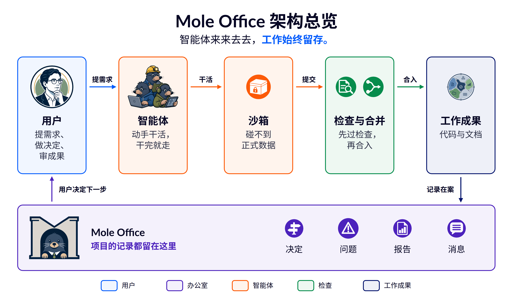
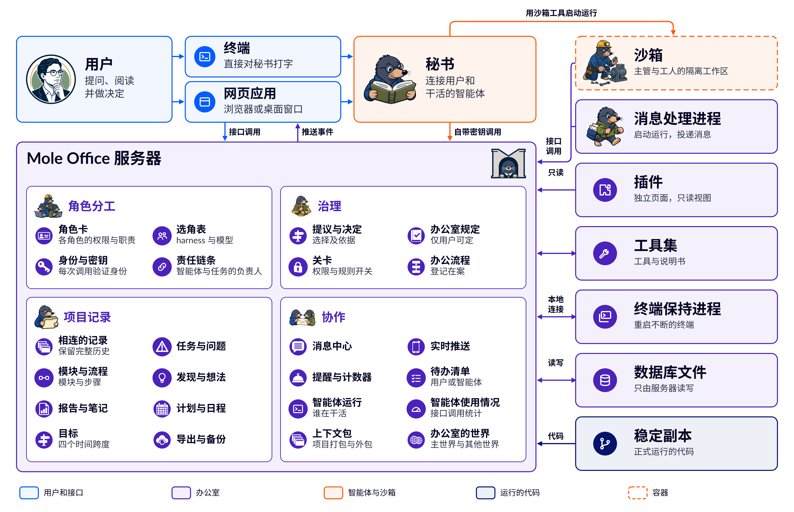
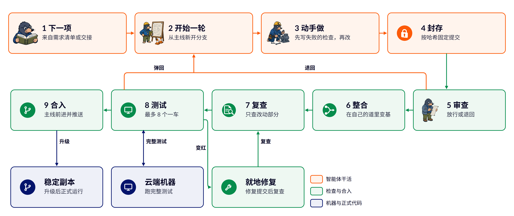

<h1 align="center">
  &nbsp;&nbsp;Mole Office
</h1>

<p align="center"><strong>你的智能体是临时的，你的工作不是。</strong></p>
<p align="center">一间为人和智能体准备的、长期存在的项目 Office。</p>
<p align="center">官网：<a href="https://moleoffice.com">moleoffice.com</a></p>

<p align="center"><a href="../README.md">English</a> · <strong>中文</strong></p>

<p align="center">
  
</p>

Mole Office 让项目跨越不同的工作者、会话、工具和对话继续活着。

计划、工作、决定、发现、报告、来源和历史都留在项目里——下一个工作者可以接着做，而不必从头把一切重新拼出来。

> **智能体干活，Office 记事。**

## 为什么要有它

你会开很多个智能体会话。每一个都做了真正的工作，也都写了不错的报告。报告堆积的速度，比任何人能把它们串起来的速度都快。

问题不在报告。问题在另外三件事：

- **状态存错了地方**——存在对话里、你的记忆里，以及还开着的终端窗口里。重启一次，这三处全没了。
- **没有东西记录“谁应该用这个结果”。** 每份报告只说自己的发现，没有一份说因此该改什么。于是一个测出来的数值，和一份写着“这个数值还缺”的文档，可以在相邻的两个文件夹里并存一个月。
- **欠下的工作和已知的事实没有分开。** 一项必须做的修复被当成一条有意思的事实归档。事实没有截止日期，所以它永远不会变成逾期。

Mole Office 保持两层。你的**档案**——报告、代码、数据——留在它们本来的位置，永不复制。**追踪层**很小、彼此有链接，也是你唯一需要记在脑子里的那部分。

## 留下来的东西

- **项目结构**——计划、工作、模块、流水线、问题、决定、发现和报告
- **项目历史**——修订、来源、检查点和证据
- **协作**——评审、消息、在做什么、范围和交接
- **实现上下文**——项目含义与代码仓库之间的链接
- **不确定性**——占位、矛盾和未完成的工作都保持显式

## 它怎么运转

1. 人表达意图。
2. 工作者拿到它需要的项目上下文。
3. 工作、证据、评审和决定回到 Office。
4. 下一个工作者从留存下来的项目状态继续。

你的智能体仍用它们自己的运行环境。Git 仍然是 Git。Mole Office 是围绕项目的那一层长期存在的东西。

**Git 拥有实现的历史。Mole Office 拥有项目的含义、协作与演进。**

<p align="center">
  
</p>

[English](../assets/architecture/general-en.png) · [SVG 源文件](../assets/architecture/general-zh.svg) · [English SVG](../assets/architecture/general-en.svg)

技术架构图展示办公室由哪些部分组成，以及各部分如何连接。详见[架构说明（英文）](../docs/architecture.md)。

<p align="center">
  
</p>

[English](../assets/architecture/technical-en.png) · [SVG 源文件](../assets/architecture/technical-zh.svg) · [English SVG](../assets/architecture/technical-en.svg)

开发流程图展示一轮工作：从下一项到合入，再到正在运行的办公室。

<p align="center">
  
</p>

[English](../assets/architecture/flow-en.png) · [SVG 源文件](../assets/architecture/flow-zh.svg) · [English SVG](../assets/architecture/flow-en.svg)

## 安装

Linux、Windows 和 Mac 的安装包都在 [Releases 页面](../../../releases)上。

装好以后，再做两步，你的智能体就能找到 Mole Office：

1. 打开**设置**，在**普通或开发者**里选**开发者**。
2. 在**每个会话的入口**下，点**放置入口**。

想从源码运行，就用下面[运行它](#运行它)一节的开发方式，记得链接 skill。想自己构建安装包，或者想知道哪些地方还不能用，请看 [RELEASE-NOTES.md](../RELEASE-NOTES.md)（英文）。

> **预发布：** 还没有发布 npm 包。

<!--
只有在包/命令行的形态真实存在并已验证之后，才启用下面的内容。

可能的形式——选与实际打包方式相符的那一种：

npm install -g mole-office

或者，如果它本来就不需要全局安装：

npx mole-office

或者，如果包属于某个组织命名空间：

npm install -g @mole-office/cli
-->

## 运行它

```bash
npm install                 # 需要 Node 22 或更新版本
cp .env.example .env      # 每项设置都有可用的默认值；改之前先读注释
ln -s "$PWD/skills/mole-office" "/你的智能体目录/skills/mole-office"  # 把目标路径替换为你的智能体所使用的 skills 目录
npm run db:migrate
npm run db:seed           # 示例数据，让界面上有东西可看
npm run dev               # 接口在 8787，浏览器应用在 5173
```

`npm run dev` 用 Mole Office 自己的开发监督进程来跑接口：服务器所依赖的文件一变就重启，崩溃后自动拉起，运行时页面（`#/runtime`）会写明监督者是谁、上一次重启的原因。

> **重要：** 必须把 Mole Office skill 链接到智能体的 `skills` 目录。没有这个链接，Mole Office 仍能运行，但智能体不了解项目工作方式，实际使用会困难得多。

打开 [http://127.0.0.1:5173](http://127.0.0.1:5173)。

你的工作存在一个 SQLite 文件里，而那是唯一的一份。在任何迁移或重置之前，用 `npm run db:backup` 备份——不要用 `cp`，它会丢掉最近的写入。命令、端口和那些会浪费你时间的坑，都在 [docs/development.md](../docs/development.md)。

## 在 Mole Office 中与智能体对话——右键点击任意对象

<details>
<summary>展开查看交互方式</summary>

选中某样东西，说出你想要什么，智能体就会拿到那一份确切的上下文。计划中的一行、排期里的一个区块、一条记录、列表里的一行，或者你在正文里选中的一段文字，都带一个入口，打开同一个小框：你选了什么、你想要什么、这是给谁的。

**打开那个框有三种方式，右键最快。**

| 手势 | 作用 |
|---|---|
| **右键点击任意对象** | 一次按键，打开关于它的那个框。 |
| **`Shift+F10`** | 同样的东西，用键盘打开，针对当前获得焦点的对象。 |
| **侧栏里的 `Ask agent`** | 先按它，再按要问的对象。这是触摸屏、平板，以及任何没有右键的地方的入口。 |

侧栏控件旁边现在用同样的措辞写着同一句话，好让这两条渠道教的是同一个手势，而不是两个。

</details>

## 什么是 Office

**办公室（Office）**是一个长期存在的项目环境，被一批临时的工作者共享。

技能（Skill）帮工作者做成一件事。框架（Harness）在工作者干活时引导它。Office 则在那个工作者离开之后，让项目仍然连贯。

> **Mole Office 把临时的智能变成机构的智能。**

## 运行原则

- **一个事实，一个身份，多种呈现。**
- **真实优先于方便。**
- **“没有”胜过猜测。**
- **人的治理仍归人。**
- **局部可以搁置，整体继续推进，完成之前必须对齐。**
- **每个工作者都应该让项目比他来时更丰富。**

其中三条是写进代码里的，不是口号。

- *真实优先于方便*：某个方法跑不了，就明确失败并说出来。换一个方法跑完再报告成功是被禁止的——那样得到的结果，是关于没人问过的那件事的证据。
- *“没有”胜过猜测*：`unknown`、`unverified` 和“没有人看过”都是真正的答案。Mole Office 会把“那里什么都没有”和“没有人看过”分开，并说明是哪一种。
- *人的治理仍归人*：留给人的动作会拒绝智能体，并在拒绝时说明该改为提交什么。见 [docs/governance.md](../docs/governance.md)。

## 今天能用的部分

<details>
<summary>展开查看今天已经验证可用的能力</summary>

下面每一条都对着运行中的产品核对过：第一组在 2026 年 8 月 27 日，第二组在 2026 年 9 月 3 日和 4 日由独立的验证者核对。第一组怎么核的、请求和回复是什么，写在 [docs/verification.md](../docs/verification.md)；第二组写在 `design/*/verification/` 下的验证报告里。

- **上下文包。** `GET /api/bundles/preview` 会按用途组装项目上下文——继续这项工作、评论一个模块、调查一个问题、恢复一个项目——并把“什么限制了这些内容”放在正文之前。
- **历史与来源。** 每次写入都有署名并被保留。一条记录的各个修订可以读取、比较和恢复，变更日志是独立的持久表。
- **实现地图。** 记录可以和实现它的代码关联，而且每条关联都说明是人明确声明的，还是产品猜出来的。
- **会话与智能体运行。** 会话是一条记录，运行是工作者认领的一行，接口会回答某次运行归属于哪里、依据是什么。
- **等你处理的队列。** `GET /api/needs-you` 返回那些只能由人来做的选择，并说明每一件为什么是人的。
- **有类型的记录和链接。** 一张表装下项目知道的每一种东西，有类型的链接把任意两条连起来。`GET /api/kinds` 提供全部种类、字段和链接类型，因此不需要把它们抄进一份会过期的文档。
- **模块、区块与流水线。** 模块是你会为它单独写一份报告的子系统；流水线是有序的区块集合；区块本身就是一条记录，有自己的历史。
- **导出与恢复。** 整个语料库可导出为可读的 Markdown，也能从中恢复。破坏性恢复验证在 2026 年 8 月 27 日跑过：十四个阶段、二十六项比对全部成立、没有一项是空比对，而三件无法完整往返的事由验证本身逐条声明。
- **搜索。** `GET /api/search` 返回命中的记录，以及命中的是哪些词。
- **项目。** 每条记录、每条链接、每行变更都属于某一个项目，每个请求都要说明问的是哪个项目。
- **写入对键严格，对“写了多少”宽容。** 字段名拼错会被拒绝，并告诉你它多半想写哪个字段，什么都不存；只有标题、别的都没写的记录会被存下来，并被标记为不完整，直到其余部分补上。

后来加上、并用同样方式验证过的：

- **报告的七个阅读长度。** 标签、标题、结论，再到按段落写的三级摘要，直到全文；没写的层级会说没写，不会拿别的东西顶上。
- **按管理员的话行事。** 智能体可以凭管理员说过的一句原话去接受、关闭或重新归类，记录上显示那句话，管理员一键即可撤销。
- **产品知道自己所在的世界。** 每个回复都写明数据库、仓库、端口、提交，以及是不是 canonical 世界；走错世界的页面会被红色横幅挡住并说明原因；新鲜度按每一半真正依赖的文件来判断；测试或智能体启动的每个进程都登记了所有者和世界。
- **人和智能体都是参与者。** 两个安装级的登记表，每个参与者有名字、handle、头像（按 id 生成，或自己上传）和自己设定的状态。
- **一个消息池和一个实时聊天。** 人和智能体之间的消息，每个收件人有投递标记，通过一条事件流在毫秒内到达打开的页面；右下角的圆圈打开聊天；在线与否由真实运行推导，不靠声明。
- **智能体在页面上评论并带路。** 智能体的消息可以指向一个区块、一片区域或一段文字，画在它旁边；带路只在你同意后才移动页面，一键即停。
- **一个运行智能体工具的 worker。** 发给智能体的消息会在 checkout 内启动或续接一次 Claude Code、Codex 或 OpenCode 的运行，数据库只能经接口访问；回复归入消息池；运行有上限，可从产品内停止。
- **群组与工作认领。** 群组是多人参与的会话；智能体认领自己在做的东西，两条认领指向同一处时自动开群并把管理员拉进去。
- **经过审计的测试集。** 每个测试文件都按它守护的规则、规则被破坏时是否变红、是否断言了没人决定过的实现细节来分类。

</details>

## 正在建设中的部分

<details>
<summary>展开查看正在开发的能力</summary>

以下都已设计、部分已实现。没有一项是完成的；产品会在你遇到它的地方说明这一点，而不是给出一个看起来像答案的空结果。

- **更完整的评审与接续。** 今天评审可以收集意见并发给智能体。接续那一半——让工作者从上一位停下的地方精确接手——还没完成。
- **显式的不确定性。** 占位标记一件被刻意悬置的事，并限定它周围的工作可以宣称什么。种类和读取它的机制都已存在。
- **从另一台机器访问 canonical 世界。** 标准已写好：经管理员的私有网络打开的页面连到同一个世界，带同样的事实和同样的横幅，远程客户端会被点名；正在构建。
- **公民、世界与外交办。** 每个人和智能体都是某个家园世界的公民；世界的出生与死亡有记录；到别的世界出访要在主世界的外交办登记，主世界的页面列出各个世界、可以进入并返回。标准按管理员 9 月 4 日的话写好，接下来就建。
- **身份。** 没有登录。调用者是谁来自请求头，那是署名，不是认证。先做公民身份，家园世界签发的通行证在其后。

</details>

## 文档

这份 README 是有意写短的。细节在 [docs/](../docs/README.md)，按你要问的问题来组织：

| 你想知道 | 读 |
|---|---|
| 这些词是什么意思——Office、模块、区块、流水线 | [docs/concepts.md](../docs/concepts.md) |
| 项目怎么存——记录、链接、完整性 | [docs/project-model.md](../docs/project-model.md) |
| 系统是怎么搭起来的 | [docs/architecture.md](../docs/architecture.md) |
| 智能体怎么读和写 | [docs/agents.md](../docs/agents.md) |
| 谁在工作，没人工作时会怎样 | [docs/lifecycle.md](../docs/lifecycle.md) |
| 评审怎么运作 | [docs/review.md](../docs/review.md) |
| 哪些事只有人能决定 | [docs/governance.md](../docs/governance.md) |
| 计划、工时，以及人写下的关于时间的话 | [docs/planning.md](../docs/planning.md) |
| 项目含义怎么和代码关联 | [docs/implementation-map.md](../docs/implementation-map.md) |
| 怎么把上下文交给一个工作者 | [docs/context-bundles.md](../docs/context-bundles.md) |
| 悬而未决的事怎么保持悬而未决 | [docs/placeholders.md](../docs/placeholders.md) |
| 从另一台机器访问 | [docs/remote-access.md](../docs/remote-access.md) |
| 怎么运行，以及有哪些坑 | [docs/development.md](../docs/development.md) |
| 这里的说法是怎么核对的 | [docs/verification.md](../docs/verification.md) |
| 那几张图，以及做图标还缺什么 | [docs/brand.md](../docs/brand.md) |

## 许可

Mole Office 以 MIT 许可证发布。许可证见 [LICENSE](../LICENSE)，[NOTICE](../NOTICE) 用一行说同样的事。
